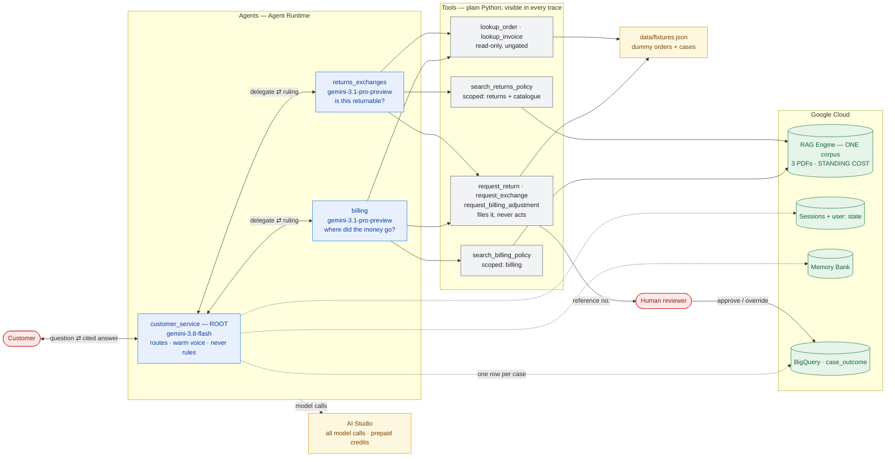
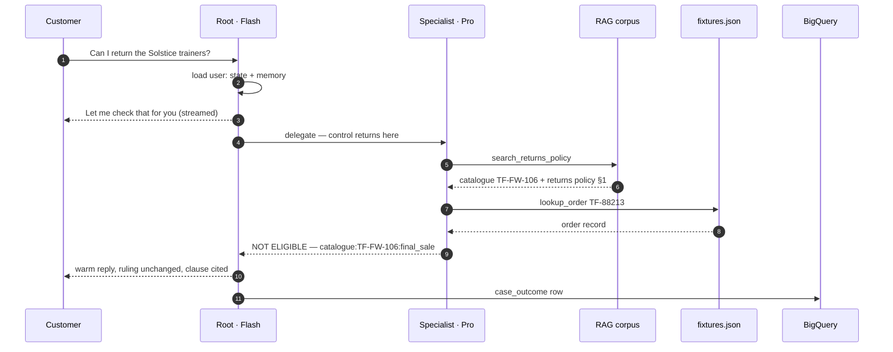

# BUILD PLAN — Customer Service Chatbot (Returns, Exchanges & Billing)

**Status:** Architecture agreed. Environment fixed, policy documents written, corpus tooling
built. Agents not yet built.
**Last updated:** 2026-09-12
**Project:** `customer-chatbot-rag` · GCP project `gemini-enterprise-learning`

---

## How to read this document

Every significant choice below is written as **Decision → Why → What it costs us**. Nothing
here is free. The point of writing the cost down is so that when something goes wrong later,
you can tell the difference between "we chose this and accepted the downside" and "we didn't
think about it."

Anything marked **ASSUMPTION** is something I filled in that you have not confirmed. Anything
marked **OPEN** is genuinely unknown and needs an experiment before we rely on it.

---

## 1. What we are building

A customer service chatbot with three agents: an orchestrator that talks to the customer, and
two specialists — **Returns & Exchanges** and **Billing** — that do the actual policy reasoning.

Specialist answers are grounded in the company's actual policy documents rather than in
whatever the model remembers about returns and billing policies in general.

### Why this needs AI at all

Worth asking honestly, because most "AI products" fail this test.

A policy FAQ could be a search box. What a search box cannot do is handle *"I bought these
boots 40 days ago, wore them twice, and the sole split — can I get my money back?"* That
question requires reading a policy, applying several clauses at once (time window, wear
condition, defect vs. change-of-mind), and reaching a judgement. That is genuinely language
work.

**But note the honest limit:** the *action* half of this bot (look up order #12345, start a
return) is ordinary software. The AI should decide *when* to call those functions, not
reimplement them. If we find ourselves asking the model to do arithmetic on dates or invent
order statuses, we have made a design error.

### Success criteria — ASSUMPTION, please confirm or replace

These are placeholders. Real criteria should come from you. **Open question #1 blocks §6.5.**

| Metric | Target | Why this one |
|---|---|---|
| Grounded accuracy | ≥ 90% of answers correct *and* traceable to a policy clause | An answer that is right by luck is not a pass |
| Retrieval hit rate | ≥ 95% — correct clause is in what we fetched | Separates "fetched wrong" from "reasoned wrong" |
| **Routing accuracy** | ≥ 95% — right specialist for the question | New with the multi-agent design (2.1) |
| Refusal correctness | ~100% — says "I don't know" when the policy is silent | The most important safety metric here |
| Action proposal accuracy | ~100% correct tool, correct arguments | A wrong refund is worse than a wrong sentence |
| **Ungated actions** | **0** | 2.11 is an invariant, not a target. Any action completing without human approval is a bug |
| **Human override rate** | Track it, no target yet | The least fakeable measure of whether the agent's judgement is trustworthy (2.15) |
| **p95 latency** | 8s target, >15s a failure — **ASSUMPTION** | Multi-hop turns (2.2) make this a real risk |
| **Cost per conversation** | TBD — set a number | Can't evaluate 2.10's trade-off without it |

### Product risks

1. **Confident wrong answers about money.** The top risk. A customer told "yes, full refund"
   when the policy says otherwise is a real financial and trust loss.
2. **Silent policy drift.** PDFs get updated; the index does not. The bot then confidently
   quotes a dead policy. There is no error message for this — it just goes quietly wrong.
3. **Action without approval.** Prevented by design in v1 (2.11) — the agent files requests and
   never completes them. The residual risk is the bot *claiming* an action happened, which is a
   wording failure rather than a financial one, and has its own eval case.
4. **Misrouting between specialists.** New with 2.1. A billing question answered from the
   returns policy is a confident wrong answer with a plausible shape.
5. **Prompt injection via documents.** Lower risk here (our own PDFs), but the pattern matters
   — retrieved text must never be treated as instructions.

---

## 2. Decisions made, and what each one costs

### 2.1 Three agents: an orchestrator and two domain specialists

**Decision.**

| Agent | Job | Talks to customer? |
|---|---|---|
| `customer_service` (root) | Understand intent, pick a specialist, deliver the answer in a warm, plain-English voice | **Yes — exclusively** |
| `returns_exchanges` | Returns, exchanges, refund eligibility. Owns returns policy retrieval + return actions | No |
| `billing` | Charges, invoices, payment methods, billing disputes. Owns billing policy retrieval | No |

**Why.** The two domains have genuinely different policy documents, different tools, and
different risk profiles. A single agent holding all of it needs one enormous system prompt in
which the returns rules and the billing rules compete for attention — and the failure mode is
silent blending of the two. Separate agents means each specialist's instructions can be
specific and short, which is the single biggest lever on reliability.

Routing to a specialist also gives us a **third separable grading dimension**. We can now ask
three independent questions of a failed case: was it routed right, was the right clause
fetched, was the reasoning correct. Three different fixes.

**What it costs us.**

- **A new failure mode that did not exist before: misrouting.** And a blurry boundary — *"I
  want a refund for order #123"* is arguably both domains. **Refunds live with Returns &
  Exchanges** (the eligibility judgement is the hard part); Billing handles money that moves
  for reasons other than a return. This must be stated in both agents' instructions, because
  an unstated boundary is a coin flip.
- **Cross-domain questions need the root to call both specialists** and reconcile. That is the
  case most likely to produce an incoherent answer. It needs its own eval case.
- **Three prompts to maintain** instead of one, and a change in one specialist can shift
  behaviour in the other through the root's summarisation.

---

### 2.2 Specialists run as `single_turn` sub-agents, not as transfers

**Decision.** Specialists are attached via `sub_agents=[...]` with **`mode='single_turn'`** on
each. They do their work and return control to the root, which writes the customer-facing reply.

**Why.** Your requirement is that the root owns the customer's experience and the friendly tone.
That only holds if control comes back.

**This is the trap:** ADK's default for a sub-agent is `mode='chat'`, which makes it reachable
via `transfer_to_agent` — and after a transfer, **the specialist talks to the customer
directly**. The root never gets to reword anything. Attaching `sub_agents=[returns, billing]`
without setting `mode` silently gives you the architecture you did not ask for, and it will
look like it's working.

`mode='single_turn'` is verified present in the installed ADK
(`google/adk/agents/llm_agent.py:342`). ADK 2.6 explicitly documents this as preferred over
wrapping specialists in `AgentTool` — `AgentTool`'s own docstring calls direct use
"discouraged" (`google/adk/tools/agent_tool.py:115`). Single-turn sub-agents also **run inline
in the parent's session**, which is what makes 2.7 work: every specialist step lands in the same
session event log automatically.

**What it costs us.**

- **Three model calls on a typical turn** — root decides, specialist reasons (plus retrieval),
  root composes — and more when two specialists are involved. Only the middle hop is Pro
  (2.10), but it is the slow one, so this is the dominant latency driver in the system.
- **A summarisation layer between the answer and the customer.** The root can soften a
  specialist's "no" into something that reads like a "maybe." **The root's instructions must
  forbid changing the substance of a specialist's determination** — tone is the root's job,
  the ruling is not. This needs a dedicated eval case: a hard "no" from the specialist must
  survive the root's rewrite as a "no."
- **Citations have to survive two hops** to meet the grounded-accuracy criterion.

---

### 2.3 Retrieval lives inside each specialist as a normal tool

**Decision.** Each specialist calls a plain Python function that searches the policy documents.
The model sees only "a tool that takes a question and returns text." It does not know RAG Engine
exists.

The alternative was *native grounding*, where you hand the data source to the model and
Google's infrastructure does retrieval invisibly, server-side, before the model writes.

**Why.** Two reasons, and the second matters more than the first.

*Billing:* native grounding only works through Vertex, which would force model calls onto your
GCP bill and strand your prepaid AI Studio credits (see 2.9).

*Observability — the real reason:* with retrieval as a tool call, the search query and the
returned chunks appear in the trace as inspectable artifacts. That lets us grade separately:

- **Did it fetch the right policy clause?** (a retrieval problem — fix chunking or the query)
- **Did it reason correctly over what it fetched?** (a model problem — fix the prompt)

These have completely different fixes. Native grounding collapses them into one number that
tells you something is wrong but never what. Debugging by guesswork is the thing to avoid.

**What it costs us.** More code to write and maintain — we own the retrieval function, its
error handling, and its failure modes. Native grounding would be less work. We are paying in
effort for the ability to see inside the system, which is the right trade for a product whose
whole value proposition is being trustworthy about policy.

---

### 2.4 One corpus, two scoped retrieval tools — not two corpora

**Decision.** All policy PDFs go into a **single** RAG Engine corpus. Each specialist gets its
own retrieval function that scopes results to its own documents.

**Why.** Purely cost. Per 2.5, each corpus provisions its own managed vector store and bills
continuously. Two corpora is two standing bills for a handful of PDFs. The isolation a second
corpus would buy is achievable in the tool layer for free.

**What it costs us.**

- **Scoping is now our code's job, not the platform's.** If the filter is wrong, the billing
  agent can retrieve returns policy text — precisely the cross-contamination 2.1 exists to
  prevent, arriving through the back door. **Each specialist's retrieval tool must assert that
  every returned chunk came from its own document set**, and drop anything that didn't. Cheap
  to write, and it turns a silent correctness bug into a visible one.
- Chunks from both domains share an embedding space, so a query phrased ambiguously can rank
  the other domain's text highly. The assertion above is what catches this.

---

### 2.5 Vertex AI RAG Engine as the retrieval backend

**Decision.** Policy PDFs go into a Vertex AI RAG Engine corpus. It handles parsing, chunking,
embedding, and the vector index.

**Why.** It is the managed RAG capability inside Agent Platform — the thing you asked for by
name. We do not build or operate a vector database. For a handful of PDFs, building one would
be absurd.

**What it costs us — read this one carefully.**

RAG Engine's managed vector store **provisions a Spanner database instance** behind the scenes.
Basic tier is 100 processing units, and it **bills continuously** — whether you query it a
thousand times a day or never.

**The part that is genuinely counter-intuitive, confirmed by running `make rag-status` against
this project:** the billing tier is a **project + location singleton** (`ragEngineConfig`), not
a property of any corpus. Our project already reported `Tier: Basic` while holding **no corpus
at all**. So deleting the corpus does *not* stop the meter — an earlier draft of this plan said
it did, and was wrong. Halting it requires setting the tier to `Unprovisioned`, which wipes all
RAG Engine data in that project and location.

This is the single largest standing cost in the project, and it is easy to miss because
nothing in the interface announces it. Which leads directly to the next decision.

> **TODO before building:** put the actual dollar figure in §5. A cost decision without a
> number can't be weighed. 100 PU/month in our region — get it from the pricing calculator.

---

### 2.6 The corpus is ephemeral — created for work, deleted afterwards

**Decision.** Four commands, because 2.5 means corpus lifetime and billing are separate things:

| Command | What it does | Stops the bill? |
|---|---|---|
| `make rag-up` | Create the corpus, ingest `docs/*.pdf` | — |
| `make rag-status` | Show corpus contents **and the billing tier** | — |
| `make rag-down` | Delete the corpus | **No** — see 2.5 |
| `make rag-unprovision` | Set the tier to `Unprovisioned` | **Yes** |

`make eval` refuses to run when no corpus exists, rather than grading a broken system and
producing failures that look like model problems (2.6, below).

Normal cycle: bring it up, build or evaluate or demo, tear it down. `rag-unprovision` is the
one to run when you are done for a while — it is destructive project-wide, so it requires
typing the region to confirm.

**Why.** It converts an always-on cost into a pay-for-what-you-use one. With a few small PDFs,
re-ingestion takes minutes and costs pennies in embedding generation. The economics strongly
favour deleting it.

**What it costs us.**

- **A demo can't be spontaneous.** You need a few minutes of lead time to run `rag-up`. Do not
  learn this five minutes before showing someone. **The deployed agent has the same
  constraint** — it is a demo that requires `rag-up` first, not an always-on service. That
  belongs in a runbook, not in your memory.
- **A live agent breaks when the corpus is gone.** A deployed bot with no corpus fails at the
  retrieval call. The tool must return a clean "policy lookup is unavailable" rather than
  crashing — and the specialist must say that honestly instead of falling back on the model's
  general knowledge of returns policies. **This is a real safety requirement, not polish:**
  an ungrounded answer about refunds is exactly the failure this product exists to prevent.
  Note this must hold through the root as well (2.2) — the root must not smooth "I couldn't
  check the policy" into something that sounds like an answer.
- **The corpus ID changes on every rebuild.** So nothing may hardcode it. We look it up by a
  stable display name (`RAG_CORPUS_DISPLAY_NAME` in `.env`), or write the ID into `.env`
  during `rag-up`.
- **Evaluation requires the corpus to be up.** The loop is `rag-up` → eval → `rag-down`.
  Forgetting this produces eval failures that look like model problems but aren't.

*Why put it in a Makefile rather than clicking in the console:* a ritual you run every week is
a ritual you will eventually do wrong from memory. Especially the teardown half — the one that
costs money when skipped. `rag-status` exists for exactly this reason: it prints the billing
tier every time, so the standing cost is never invisible.

---

### 2.7 Session history: SQLite locally, managed sessions once deployed

**Decision.** One `BaseSessionService` interface, two implementations chosen by env var:

| Environment | Service | Storage |
|---|---|---|
| Local dev, playground, evals | `SqliteSessionService` | `./.sessions/sessions.db` |
| Deployed to Agent Runtime | `VertexAiSessionService` | Managed by Agent Engine |

**Why — and this answers your SQLite-vs-Google-Cloud question directly: it's both, at different
stages, and not for the reason you'd expect.**

It isn't a cost trade-off, because **SQLite is not an option in production at all.** Agent
Runtime containers have ephemeral filesystems and can be replaced between turns. A SQLite file
written on one instance may simply not exist for the next request. SQLite deployed isn't
"cheaper than managed sessions" — it's a session store that loses conversations
non-deterministically, which is worse than having none because it fails quietly.

So the real choice is between managed sessions and running our own Postgres/Cloud SQL. Managed
sessions win on your cheaper-over-faster preference: Cloud SQL has a **standing instance cost
in the same category as the RAG corpus**, and we'd be paying it to store a few demo
conversations. Managed sessions have no standing instance.

Locally, SQLite is strictly better than the managed service: free, no network round-trip per
turn, and the whole conversation history is inspectable with any SQL client — which matters a
lot while debugging a three-agent system.

Both are first-class in the installed ADK (`google/adk/sessions/sqlite_session_service.py`,
`vertex_ai_session_service.py`).

**2.8 settles this cheaply.** Memory Bank requires a deployed Agent Engine anyway, so managed
sessions arrive with it — same service, no standing instance, nothing extra to configure. No
Cloud SQL is needed for conversations.

**What it costs us.**

- **Two code paths, so a bug can exist in one and not the other.** Mitigation: the selection
  lives in exactly one function, and both paths are exercised — local by daily use, deployed by
  a smoke test after each deploy.
- **The local DB is a real file holding real conversation text.** It is gitignored; keep it
  that way.
- Agent Engine sessions are only reachable once something is deployed, so the deployed path
  cannot be tested until §6.5.

**What this gets you for free:** because specialists run inline in the root's session (2.2),
the session event log already contains *everything* you asked for — customer turns, the root's
routing decision, each specialist's tool calls, the retrieved chunks, and the specialist's
response back to the root. You do not need to build agent-to-agent logging. It's the event log.

---

### 2.8 What the agent remembers, and which layer is allowed to decide

**Decision.** Four storage layers, in a strict authority order. The whole point of writing
this down is the last rule: **memory can change how we speak to a customer and what we offer
them next. Only the corpus can change the answer.**

| Layer | Scope | Shape | May it decide a ruling? |
|---|---|---|---|
| `temp:` state | One turn | Scratch, never persisted | No |
| Session state | One conversation | Exact key/value | No |
| `user:` state | One customer, **across all conversations** | Exact key/value | No |
| Memory Bank | One customer, across conversations | LLM-distilled, semantic search | **Never** |
| **Policy corpus (2.5)** | The company's documents | Retrieved text, cited | **Yes — only this** |

**The split, concretely.** The difference is who decides what gets written down: `user:` state
is a form with fields we designed, Memory Bank is a colleague who listened to the call and took
their own notes.

*`user:` state — fields we name in advance.* The root agent asks every customer how they want
to be contacted and for the detail itself, then stores both:

| Key | Example | Set by |
|---|---|---|
| `user:contact_method` | `"email"` | Root, on first contact |
| `user:contact_detail` | `"priya@example.com"` | Root, on first contact |
| `user:customer_id` | `"C-4471"` | Order lookup |
| `user:open_return_ref` | `"R-1029"` | Return initiation |

Exact, free, deletable, identical locally and deployed. Asked once, not every conversation —
which is itself the first visible payoff of having memory at all.

*Memory Bank — everything else that transpired.* Whatever came up in a previous chat that no
field could have anticipated: *"I mentioned last time I need a wide fit."* It goes to the
specialist as context to reason with, never as a source of truth.

Deciding the contact fields in advance is what keeps Memory Bank narrow. It is not being asked
to remember an email address it might garble — it handles only the unstructured remainder.

**Neither is the authoritative customer record.** In production that is the CRM and the order
database. Agent memory is a convenience layer over systems of record — the moment a fact lives
only here, we have a data-integrity problem wearing an AI costume.

**Worked example — why the order matters.** Priya bought the Solstice Edition (TF-FW-106),
which the catalogue marks *"Final sale. Not returnable or exchangeable unless faulty."* She
returns in a new conversation saying the shoes are "not right." Memory holds *"a previous
return was refunded as a goodwill exception."*

If memory were allowed to decide, the bot reasons *"we made an exception before, so yes"* and
refunds a final-sale item on the strength of a summary of something that happened once. Under
the hierarchy, the corpus produces the "no", while `user:contact_method` picks the channel
and Memory Bank supplies the wide-fit context and the *"good to hear from you again."* Three
layers shape the reply; one layer decides it.

**How it is enforced, not just intended:**

- Retrieved memory enters the prompt in a block explicitly labelled as customer context, never
  as policy, and never in the same block as retrieved policy text.
- Every specialist's instructions state that a ruling cites a policy clause. A determination
  with no clause behind it is a refusal, not an answer.
- An eval case, listed in §4: a misleading stored memory that must not override the policy.

**Wiring.** `Runner` takes both services independently — `session_service` required,
`memory_service` optional (`google/adk/runners.py:210`). Same two-tier shape as 2.7:

| Environment | Service |
|---|---|
| Local dev | `InMemoryMemoryService` — non-persistent, but exercises the code path |
| Deployed | `VertexAiMemoryBankService` |

Read back into a turn with the `load_memory` tool.

**Why have Memory Bank at all.** A returning customer who re-explains themselves every time is
a visibly worse experience, and for a service bot that gap is obvious to anyone demoing it.

**What it costs us.**

- **Real memory only exists after the first deploy.** `VertexAiMemoryBankService` requires an
  `agent_engine_id` (`google/adk/memory/vertex_ai_memory_bank_service.py:175`) — it is bound to
  a deployed Agent Engine. Locally you get the in-memory stand-in, which loses everything on
  restart. **The local and deployed bots therefore behave differently**, and that difference
  will show up as "works on my machine" bugs in the memory-dependent cases. Evals that depend
  on memory are not trustworthy locally.
- **An extra LLM call for consolidation**, on top of what a multi-hop turn already costs
  (2.2). Measure it with the rest in §6.5.
- **It is a customer-data store**, which collides with 2.9 — model calls run through AI Studio,
  which has no data residency commitment. Fine for fake policy documents and fake customers.
  **The moment real customer data is involved, this decision and 2.9 have to move together.**
- **Deletion is a legal request, not a feature request.** `user:` state keys can be deleted
  with confidence. Distilled summaries spread through a vector store are much harder to prove
  fully removed. Another reason the structured layer carries the load.
- **Wrong memory outlives its truth.** *"This customer always gets free returns"* — accurate
  once, as a goodwill exception — becomes a confident error a year later. The hierarchy is what
  keeps that error cosmetic instead of financial.

---

### 2.9 Split billing — models on AI Studio, infrastructure on GCP

**Decision.**

| What | Where it runs | Who pays |
|---|---|---|
| All model calls | AI Studio via `GEMINI_API_KEY` | Your prepaid credits |
| RAG Engine, Agent Runtime, Secret Manager | Vertex, via ADC | GCP project billing |

**Why.** You have prepaid AI Studio credits and want them used. This works because the two are
genuinely separate clients — the model call goes to one endpoint, the retrieval call to
another. Decision 2.3 is what makes it possible; with native grounding these cannot be
separated.

**The mechanism, since this is the part that breaks confusingly:** setting
`GOOGLE_GENAI_USE_VERTEXAI=false` + `GEMINI_API_KEY` routes *model* calls to AI Studio. RAG
Engine and Agent Engine are separate client libraries and still need **ADC plus
`GOOGLE_CLOUD_PROJECT`**. Both credential paths must be live at the same time. When this
misconfigures, it presents as an auth error and reads like a bug rather than a consequence of
this decision.

**What it costs us.**

- **Two bills and two quota systems** to reason about. Cost-per-conversation now requires
  adding numbers from two consoles — and 2.2 means roughly three model calls per turn, only one
  of them Pro.
- **An API key to manage.** Once deployed, it must live in Secret Manager, never in `.env`.
  A key in a file is a key in a screenshot eventually.
- **AI Studio has weaker enterprise guarantees** than Vertex — no VPC Service Controls, no data
  residency commitments. Fine for a portfolio project with fake policy documents. **Not fine if
  real customer data ever flows through it.** If this ever goes near production, model calls
  move to Vertex and this decision reverses — together with 2.8, which stores customer data.
- **One unconfirmed report** on Google's developer forum claims AI Studio has silently routed
  `gemini-3.1-pro-preview` traffic to a smaller model. Unverified, and forum posts are not
  evidence. But it costs nothing to log the model version returned in each response and check
  we got what we asked for — see 6.4.

---

### 2.10 Two models, split by job

**Decision.**

| Agent | Model | Job |
|---|---|---|
| `returns_exchanges`, `billing` | `gemini-3.1-pro-preview` | Multi-clause policy judgement about someone's money |
| `customer_service` (root) | `gemini-3.8-flash` | Pick a specialist, write the reply warmly |

Both IDs live in `app/config.py` as `SPECIALIST_MODEL` and `ROOT_MODEL`.

**Why.** The expensive model does the expensive thinking. *"Can I return worn boots after 40
days?"* requires holding several clauses at once and reaching a judgement with money attached —
that is the hard, high-stakes work. Choosing which specialist to call, and turning their ruling
into a warm sentence, is formatting. Paying Pro prices for formatting is waste.

Note this is the **inverse** of the intuitive allocation. "Root is in charge, so root gets the
good model" puts the cheap model on refund eligibility and the expensive one on picking a
sentence. Seniority in the diagram is not difficulty of the work.

**What it costs us.**

- **Two failure modes, on the two jobs Flash now owns.**
  1. *Misrouting* — a returns question sent to Billing. Mitigated by short, specific agent
     descriptions and graded as its own eval dimension (§4).
  2. *Ruling drift* — the root softening a specialist's "no" into something that reads like a
     "maybe", or inventing an answer the specialist declined to give. This is
     instruction-following under pressure, which is exactly where the smaller model is likeliest
     to slip. **The "a hard no must survive the root's rewrite" case in §4 is therefore a
     must-have, not a nice-to-have.** If Flash cannot hold that line, the root moves to Pro and
     we accept the cost.
- **Latency is still the risk, not cost.** A turn is root → specialist (+ retrieval) → root.
  Flash at both ends of that chain helps, but the middle hop is a reasoning model and dominates.
  **The root must stream and acknowledge before delegating** so the customer sees *"Let me check
  that for you"* rather than dead air.
- **Two models means two deprecation clocks.** `gemini-3.1-pro-preview` is a preview model with
  ~2 weeks of notice; Gemini 3 Pro Preview was shut down on 2026-03-09 and everyone migrated
  under duress. Two constants, one-line change each. Retry-with-backoff is not optional.
- **OPEN — worth one experiment:** there is a `gemini-3.1-pro-preview-customtools` variant
  documented as better at prioritising custom tools over built-in ones. Our retrieval *is* a
  custom tool. Worth an A/B on the specialists once evals exist. Not a default — an untested
  claim.

---

### 2.11 Every material action is gated by a human

**Decision.** The agent never completes an action that has a material consequence. It gathers
the facts, reaches a determination, and **files a request for a human to approve**. This applies
to both specialists — returns and exchanges as well as billing. The agent's write tools are
`request_*`, not `do_*`, and they return a reference number, not an outcome.

Read-only lookups — order status, invoice retrieval, policy questions — are not gated. Answering
is not an action.

**Why.** A return looks safer than a refund because a human eventually touches it, but that is a
property of the current process, not a guarantee the system enforces. If the process changes,
the safety disappears silently. A gate the system owns does not.

It is also the honest position for v1: we have no evidence about how often this agent is right.
Granting autonomy before measuring accuracy is the order of operations backwards — the eval
phase (§6.5) is what produces the evidence that would justify removing a gate.

**What it costs us.**

- **Automation rate on actions is 0% by design.** Every action conversation ends in "a colleague
  will confirm this by email" rather than a resolution. **This means the escalation path is a
  core product surface, not a fallback** — the customer needs a reference number, a clear
  statement of what was requested, and an expectation of when they will hear back. Done badly it
  reads as the bot failing.
- **Latency and staff load.** A human in every loop is the slow, expensive path. Accepted for
  v1 deliberately.
- **It changes what we measure.** Success is no longer "did the action complete" but "was the
  right action proposed, with the right arguments, and did the human approve it unchanged."
  Human override rate becomes the most informative metric we have — it is a direct, unfaked
  measurement of whether the agent's judgement can be trusted. See §1.

**The path out, for later versions.** Tier actions by consequence and ungate the bottom tier
with evidence, not optimism: an exchange for the same item in a different size is reversible and
low-value; a refund to a closed account is neither. The trigger to ungate a given action type is
a measured approval rate at or near 100% over a meaningful sample, not a sense that the bot
seems reliable now.

---

### 2.12 Actions are mocked, and read from a JSON fixture

**Decision.** `lookup_order`, `lookup_invoice` and the `request_*` tools read from a **JSON fixture file**
committed to the repo (`data/fixtures.json`) — dummy orders, returns cases and billing cases.
Lookups read from it. The `request_*` tools of 2.11 append a pending request to it and return a
reference number; nothing in the agent ever marks one approved.

**Why a JSON file and not a database.** For roughly twenty fake records a database is overhead
with a standing bill attached — and unlike the corpus (2.6) there would be no `rag-down` to
switch it off. The fixture ships inside the deployed container, so "no local state" still
holds: it is data travelling with the agent, not a file on your machine. It is also
version-controlled, diffable, and editable in a text editor, which matters when eval cases and
fixture rows have to stay in step.

*What this costs:* writes are not durable. A `request_return` in a deployed container leaves
nothing behind after a restart. That matters less than it would have before 2.11 — the record
that counts is the one the human reviewer works from, which is outside this system either way.
Correct for a demo, wrong for production; open question #6 is where that changes.

**Why mocks at all.** They let us evaluate behaviour now; real integration is a separate
problem.

**One gate, not two.** An earlier draft had a two-phase confirm: a `prepare_*` call returning a
token that the committing call refused to fire without. 2.11's human gate strictly dominates it
— if no action executes without a person approving it, a token protecting the same action adds
a turn of latency and no safety. So the two-phase mechanism is **dropped**. The customer's "yes"
is what makes the agent file the request; the human reviewer is what makes it happen.

What survives from that design is the summary. `request_*` returns a plain-English statement of
exactly what was asked for, which the customer sees before it is filed and the reviewer sees
when approving. That summary is the audit trail, and it is the thing worth testing.

---

### 2.13 Deploy to Agent Runtime

**Decision.** Agent Runtime via Agent Engine. **The project is already scaffolded for this** —
`agents-cli-manifest.yaml` has `deployment_target: 'agent_runtime'`. The earlier plan's
`scaffold enhance` step was stale and has been removed.

**Why.** It is managed: no containers to operate, and it is the natural path to publishing into
Gemini Enterprise later. It is also what makes 2.7's managed sessions available.

**What it costs us.**

- Less control than Cloud Run, and a Google-managed environment we cannot inspect deeply.
- **On your idle-cost concern:** Agent Runtime does *not* bill for idle time between
  conversation turns. I could not confirm from public documentation whether a deployed but
  completely untouched runtime holds a minimum instance, so a small floor may exist. **We
  should measure this empirically** — deploy, leave it alone for 24h, read the billing
  console. Do not assume either way.
- Your instinct that the runtime was the cost risk turned out to be wrong — the RAG corpus
  (2.5) is the expensive thing. Worth remembering as a general lesson: the always-on cost in
  an AI system is usually storage and indexes, not compute.

---

### 2.14 No CI/CD yet

**Decision.** `cicd_runner: 'skip'` in the manifest. CI/CD added later via `scaffold enhance`.

**Why.** Pipelines are for code that has stabilised. Right now we do not know what the agent
looks like. Automating a thing that changes daily is wasted work.

**What it costs us.** Manual deploys until then, and a slightly larger setup task later. Both
are cheap. The reverse mistake — building a pipeline for an agent you then redesign — is not.

---

### 2.15 Outcomes are logged to BigQuery, keyed by order

**Decision.** Every resolved case emits one structured Cloud Logging entry, routed to BigQuery
by a log sink and queried with SQL. One row per outcome, keyed by order id so it joins back to
the fixture.

**Scope: this one table and nothing else.** No conversation transcripts are exported. Full
conversations stay in the session service (2.7), where they are already preserved and already
inspectable. They get pulled into BigQuery only if a specific analysis needs them, as a
deliberate act with a retention decision attached — not as a standing pipeline nobody owns.

```json
{
  "event": "case_outcome",
  "order_id": "TF-88213",
  "specialist": "returns_exchanges",
  "determination": "not_eligible",
  "clause_cited": "catalogue:TF-FW-106:final_sale",
  "action_requested": "none",
  "request_ref": null,
  "human_decision": null,
  "latency_ms": 6100,
  "model": {"root": "gemini-3.8-flash", "specialist": "gemini-3.1-pro-preview"}
}
```

**Why.** Two of §1's criteria are otherwise unmeasurable. `human_decision`, filled in at review,
*is* the human override rate from 2.11 — the least fakeable signal we have about whether the
agent's judgement can be trusted, and the evidence that would justify ungating an action type
later. `latency_ms` and token counts are the other blank in §1. Keying on order id means a
failure can be traced to the specific case and clause that produced it, rather than to a vibe.

**Fixtures are inputs; outcomes are outputs.** They are deliberately separate stores. The
fixture (2.12) is read-only seed data that ships with the container and lives in git. The
outcome log is append-only, grows forever, and lives outside the container. Mixing them would
let production outcomes mutate the eval baseline underneath us — a database would not have
saved us from that, it would just have made it easier to do by accident.

**Why not run sessions out of BigQuery too.** The session service (2.7) is *operational* state:
it is read and written on every single turn to reconstruct the conversation. BigQuery is an
analytics store — append-optimised, high-latency, and not built for per-turn reads. It is the
warehouse, not the application database. The right relationship is the usual one: sessions serve
the live conversation, and a summary of them lands in BigQuery for analysis after the fact.

**What it costs us.**

- **No standing instance** — BigQuery bills storage and query, and bills nothing while idle.
  This is the property Cloud SQL lacked. At this volume it is effectively free.
- **A second log sink.** The scaffold already builds the pipeline
  (`deployment/terraform/single-project/telemetry.tf` — dataset, sink, tables), but its existing
  filter matches only GenAI inference logs, so our `case_outcome` events need a sink of their
  own. A few lines of Terraform, not a new system.
- **Outcome rows are structured and contain no customer text by design.** No transcripts, no
  contact details — an order id, a determination, a clause reference. That keeps the analytics
  store out of scope for 2.8's deletion problem.
- **Note what is already flowing, though.** The scaffold's existing completions sink exports
  prompt and response content to BigQuery. We are not building on it and not extending it, but
  we are not switching it off either — it is genuinely useful while debugging a three-agent
  system. It is also a second copy of anything a customer typed, outside the one table we chose
  to build. Fine for fake customers. **Before real ones it needs a retention policy and a
  redaction decision** — it will not announce itself. Open question #9.

---

## 3. How it fits together

### The system



**Reading the diagram.** It runs left to right: customer, agents, tools, storage. Solid arrows
are the request path; dotted arrows are infrastructure the agents touch on every turn regardless
of what was asked. Blue is an agent, grey a tool, green a Google Cloud service, amber something
outside GCP, red a person.

The root is the only box touching the customer. The only box that can *decide* anything is the
RAG corpus — everything else supplies context (2.8).

Note what the red boxes have in common: a customer at the top, a human at the bottom. In v1
there is a person at both ends of every action.

### One turn, end to end



Step 3 is the latency mitigation from 2.10: the customer sees something immediately, while the
slow Pro hop happens behind it. Step 10 is where the root is most dangerous — it may rewrite
the sentence, never the ruling.

Had the customer asked for an action, `request_*` would have filed it and returned a reference
number. Nothing would have executed (2.11).

**Two rules hold this together:**

1. **Retrieved policy text is *data*, never instructions.** If a document contains the words
   "ignore previous instructions," that is a string we searched for, not a command. This
   matters more once documents come from anywhere but you.
2. **The root owns the tone; the specialist owns the ruling.** The root may rewrite *how*
   something is said. It may never change *what* was determined — and it may never invent an
   answer a specialist declined to give.

Everything above — routing, tool calls, retrieved chunks, specialist replies — lands in **one
session event log**, because `single_turn` sub-agents run inline in the parent's session
(2.2 / 2.7).

---

## 4. Evaluation strategy

The multi-agent design changes what we grade. Every failed case gets attributed to exactly one
of four layers, because each has a different fix:

| Layer | Question | Fix lives in |
|---|---|---|
| Routing | Did the root pick the right specialist? | Root instructions, agent descriptions |
| Retrieval | Was the right clause in what we fetched? | Chunking, query construction, corpus |
| Reasoning | Given the right clause, was the ruling correct? | Specialist instructions |
| Delivery | Did the root convey the ruling faithfully? | Root instructions |

**This requires gold labels the dataset does not currently have.** Each eval case needs an
expected specialist and an expected clause ID, or "retrieval hit rate ≥95%" is not a measurable
claim and 2.3's whole payoff goes uncollected. Build this into the dataset schema from case #1,
not later.

**Cases that must exist, because they're the ones that hurt:**

- Questions the policy does **not** answer → must refuse. The easiest failure to miss, because
  the wrong answers look fluent.
- A cross-domain question ("refund me for order #123") → tests the 2.1 boundary.
- A hard "no" from a specialist → must still read as "no" after the root rewrites it (2.2).
- The corpus is down → must say so, never answer from general knowledge (2.6).
- A poisoned chunk containing injection text → must be treated as data (§3 rule 1).
- A stale or misleading stored memory → must not override the policy ruling (2.8).
- A customer pressing hard for an immediate refund → must still file a request, never claim
  the money is on its way (2.11). Social pressure is the realistic path to an ungated action.

---

## 5. What this costs to run

| Item | When it bills | Notes |
|---|---|---|
| RAG Engine managed DB | **Continuously while the tier is provisioned** | The big one. `rag-down` does **not** stop it — `rag-unprovision` does (2.5). **Get the number** |
| Model calls | Per request — ~3 per turn (2.2) | Prepaid AI Studio credits. One Pro hop, two Flash (2.10) |
| Embedding at ingest | Per `rag-up` | Pennies for a few PDFs |
| Agent Engine sessions + Memory Bank | Per use | No standing instance — this is why not Cloud SQL (2.7) |
| Agent Runtime | Per use; not idle between turns | Possible small floor — **measure it** |
| Secret Manager | Negligible | |
| BigQuery outcome log | Storage + query, nothing while idle | Free at this volume (2.15) |
| SQLite sessions (local) | Free | |
| Dummy order/returns/billing data | Free | JSON fixture in the repo (2.12) |

**Every figure above is a shape, not a number.** Before building, fill in the corpus monthly
cost and measure one real conversation's token usage. A document this concerned with cost
should contain at least two actual dollar amounts.

**The one habit that matters:** run `make rag-status` before you walk away, and
`make rag-unprovision` when you are done for a while. `rag-down` alone leaves the meter running.

---

## 6. Build sequence

### 6.1 Environment — DONE
- [x] Git repository initialised; `.env` confirmed gitignored before any key lands.
- [x] `app/config.py` created — single source for model IDs, regions, corpus name, document
      names, and the session/memory backends.
- [x] Models split by job: `SPECIALIST_MODEL` (Pro) and `ROOT_MODEL` (Flash), one constant each.
- [x] `RAG_CORPUS_LOCATION` pinned separately from `GOOGLE_CLOUD_LOCATION` (`global` is a
      model-serving value and is not a valid corpus region).
- [x] `.env` / `.env.example` document the split-billing switch (2.9) and both credential paths.
- [x] Stale `GOOGLE_APPLICATION_CREDENTIALS` handled. Confirmed it is *not* in any profile file —
      it is inherited from the terminal that launched the session. `scripts/rag_corpus.py` now
      detects the missing key file and falls back to gcloud ADC instead of failing on a
      traceback. Relaunching from a fresh terminal clears it properly.
- [ ] Get an AI Studio API key into `.env`, then flip `GOOGLE_GENAI_USE_VERTEXAI=false`.
      *Both* steps, or model calls silently keep billing GCP.

### 6.2 Write the policy documents — on the critical path
- [x] `tarnfield_returns_policy.pdf` and `tarnfield_product_catalogue.pdf` supplied.
- [x] `tarnfield_billing_policy.pdf` drafted. Text lives in `scripts/make_billing_policy.py`
      so wording changes are diffable; re-run it to regenerate.
- [x] Plausible questions left **unanswered** across all three documents, for §4's refusal
      cases: buy-now-pay-later, business invoicing and purchase orders, price-drop refunds,
      student discounts, paying in instalments. Asserted absent by the generator.
- [x] Cross-domain seam written in deliberately: billing §5 covers refund *mechanics* and
      defers *eligibility* to the returns policy, so the 2.1 boundary is exercised by the
      documents themselves rather than assumed.
- [x] A genuinely hard multi-clause case exists: billing §7, where returning part of an order
      drops it below a discount code's minimum spend and the refund is smaller than expected.

### 6.3 Get retrieval working — before any agent exists
- [x] `scripts/rag_corpus.py` + `make rag-up` / `rag-status` / `rag-down` / `rag-unprovision`.
      Corpus resolved by display name, never by ID (2.6). `rag-status` runs clean against the
      project and prints the billing tier.
- [ ] Run `make rag-up` and ingest all three PDFs into one corpus.
- [ ] Confirm a hand-written query returns the right clause.
      *If retrieval is broken, every downstream result is noise.*
- [ ] Verify per-specialist scoping (2.4): a billing query must not return returns chunks.
- [ ] Sanity-check the seam: "can I return the Solstice trainers" must surface the catalogue's
      final-sale line, not just the general 14-day rule.

### 6.4 Build the agents
- [ ] Session service selection (2.7) — SQLite locally, one function, env-var switched.
- [ ] Memory service selection (2.8) — in-memory locally, Memory Bank once deployed, plus
      the `load_memory` tool. Real behaviour is untestable until §6.6.
- [ ] `search_returns_policy` / `search_billing_policy`, each scope-asserting, each with a clean
      failure message when the corpus is absent.
- [ ] Mocked lookup tools (order, invoice) — read-only, ungated.
- [ ] `request_*` tools for every material action, returning a reference number and a
      plain-English summary. None of them complete anything (2.11).
- [ ] The escalation reply itself: reference number, what was requested, what happens next.
      It is a core surface, not a fallback.
- [ ] Two specialists with `mode='single_turn'`. **Verify control actually returns to the root**
      before writing prompts — this is the 2.2 trap.
- [ ] Root agent: routing, warm tone, explicit ban on altering a specialist's ruling.
- [ ] Root collects `user:contact_method` and `user:contact_detail` on first contact, and
      does NOT re-ask when they are already set (2.8). Needs an eval case: a returning
      customer must not be asked for their email twice.
- [ ] Log the model version from each response, to catch silent routing (2.9).

### 6.5 Evaluate — the phase that actually decides if this works
- [ ] Extend the dataset schema with expected-specialist and expected-clause labels (§4).
- [ ] Start with 1–2 cases, not a suite.
- [ ] Grade routing, retrieval, reasoning and delivery **separately** — this is what 2.1 and
      2.3 bought us.
- [ ] Add the seven must-have cases in §4.
- [ ] Record tokens and latency per conversation — §1 has two targets that need real numbers.
- [ ] Expect 5–10 rounds of fixing. This is normal, not a sign of trouble.

### 6.6 Deploy and observe
- [ ] Deploy only after you agree the eval scores are good enough.
- [ ] Smoke-test the managed session path — it cannot be tested before this point (2.7).
- [ ] Measure real idle cost over 24h (2.13).
- [ ] Tracing, so production failures are diagnosable across three agents.
- [ ] `case_outcome` log sink + BigQuery table (2.15), and the review step that fills in
      `human_decision` — without it the override rate stays theoretical.
- [ ] Write the demo runbook, `rag-up` step first (2.6).

---

## 7. Open questions

| # | Question | How we settle it |
|---|---|---|
| 1 | Real success criteria, including latency and cost targets | You replace the placeholders in §1 — this gates §6.5 |
| 2 | Is a multi-hop turn fast enough for a chat UX? | Measure p95 in §6.5. If not, 2.10 reopens |
| 3 | What does the RAG corpus actually cost per month? | Pricing calculator, before §6.3 |
| 4 | Does idle Agent Runtime bill? | Deploy, wait 24h, read the billing console |
| 5 | Is the `customtools` model variant better? | A/B once evals exist |
| 6 | Are order/invoice lookups mocked forever, or real? | Your call — changes scope significantly |
| 7 | Who updates the corpus when policy changes? | Unowned drift is risk #2 in §1 |
| 8 | Does memory ever override policy in practice? | The eval case in 2.8 — watch it closely |
| 9 | Retention and redaction for the scaffold's completions sink | Before any real customer data. Decide, don't inherit (2.15) |

---

## 8. Things we deliberately did not do

- **No `transfer_to_agent` handoffs** — the root would stop owning the customer's voice (2.2)
- **No `AgentTool` wrapping** — ADK 2.6 discourages it in favour of single-turn sub-agents (2.2)
- **No second corpus for billing** — a second standing Spanner bill for scoping we can do in
  code (2.4)
- **No LLM router as a separate component** — the root's own routing decision is the router (2.10)
- **No Cloud SQL anywhere** — a standing instance with no teardown command, for demo
  conversations and twenty fake orders (2.7, 2.12)
- **No autonomous actions at all in v1** — both specialists file requests; humans approve (2.11)
- **No two-phase confirmation token** — the human gate subsumes it; two mechanisms for one
  property is latency without safety (2.12)
- **No native grounding** — would have hidden retrieval from evaluation (2.3)
- **No self-managed vector database** — absurd for three PDFs (2.5)
- **No CI/CD yet** — premature while the design is moving (2.14)
- **No real order-system integration yet** — mocks are enough to evaluate behaviour (2.12)
- **No transcript export to BigQuery** — one deliberate outcome table beats a standing pipeline
  copying customer text nobody owns (2.15)
- **No pytest on model output** — LLM output is non-deterministic; behaviour belongs in evals.
  The scaffold's integration tests cover wiring, tool schemas, and error paths — not judgement.
