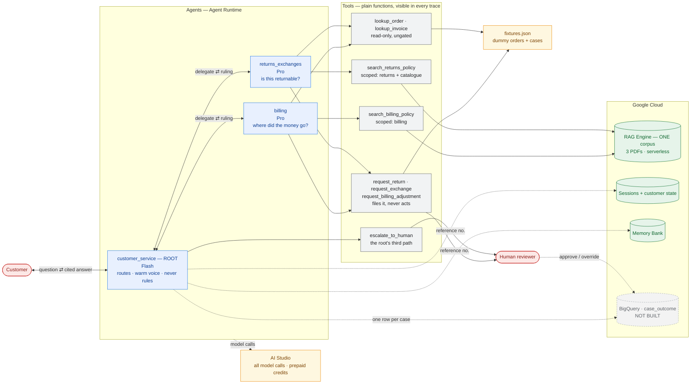
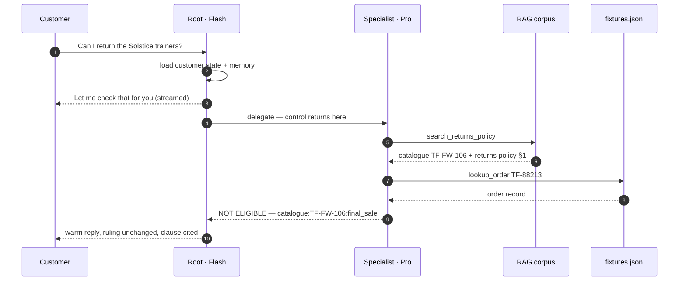

# BUILD PLAN — Customer Service Chatbot (Returns, Exchanges & Billing)

**Status:** Built and deployed to Agent Runtime. Verified answering correctly against live policy
documents. **Not yet evaluated** — §6.5 is the phase that decides whether this is actually good,
and it has not started.
**Last updated:** 2026-09-13
**Project:** `customer-chatbot-rag` · GCP project `gemini-enterprise-learning`

---

## How to read this document

This is the product document. Every significant choice is written as **Decision → Why → What it
costs us**, because when something goes wrong later you need to tell the difference between "we
chose this and accepted the downside" and "we didn't think about it."

Implementation detail lives in **[`ENGINEERING_NOTES.md`](ENGINEERING_NOTES.md)** — SDK
behaviour, file references, the traps found while building. This document says what we decided
and why; that one says how it was done.

**ASSUMPTION** marks something filled in that you have not confirmed. **OPEN** marks something
genuinely unknown that needs an experiment before we rely on it.

---

## 1. What we are building

A customer service chatbot for Tarnfield Running Co. Three agents: an orchestrator that talks to
the customer, and two specialists — **Returns & Exchanges** and **Billing** — that do the policy
reasoning.

Answers are grounded in the company's actual policy documents rather than in whatever the model
remembers about returns policies in general.

### Why this needs AI at all

Worth asking honestly, because most "AI products" fail this test.

A policy FAQ could be a search box. What a search box cannot do is handle *"I bought these boots
40 days ago, wore them twice, and the sole split — can I get my money back?"* That requires
reading a policy, applying several clauses at once (time window, wear condition, defect vs.
change-of-mind), and reaching a judgement. That is genuinely language work.

**The honest limit:** the *action* half of this bot — look up order #12345, start a return — is
ordinary software. The AI should decide *when* to call those functions, not reimplement them. If
we find ourselves asking the model to do arithmetic on dates or invent order statuses, we have
made a design error.

### Success criteria — ASSUMPTION, please confirm or replace

Placeholders. Real criteria should come from you. **Open question #1 blocks §6.5.**

| Metric | Target | Why this one |
|---|---|---|
| Grounded accuracy | ≥ 90% correct *and* traceable to a policy clause | An answer that is right by luck is not a pass |
| Retrieval hit rate | ≥ 95% — correct clause is in what we fetched | Separates "fetched wrong" from "reasoned wrong" |
| Routing accuracy | ≥ 95% — right specialist for the question | New with the multi-agent design (2.1) |
| Refusal correctness | ~100% — says "I don't know" when the policy is silent | The most important safety metric here |
| Action proposal accuracy | ~100% correct tool, correct arguments | A wrong refund is worse than a wrong sentence |
| **Ungated actions** | **0** | 2.11 is an invariant, not a target. Any action completing without human approval is a bug |
| Human override rate | Track it, no target yet | The least fakeable measure of whether the agent's judgement is trustworthy (2.15) |
| **p95 latency** | 8s target — **measured 22.9s deployed** | A turn is 4–6 sequential model calls, 2–4 on the expensive model (2.2). The target needs re-setting or the design does |
| Cost per conversation | TBD — set a number | Can't evaluate 2.10's trade-off without it |

### Product risks

1. **Confident wrong answers about money.** The top risk. A customer told "yes, full refund" when
   the policy says otherwise is a real financial and trust loss.
2. **Silent policy drift.** PDFs get updated; the index does not. The bot then confidently quotes
   a dead policy. There is no error message for this — it just goes quietly wrong.
3. **Action without approval.** Prevented by design in v1 (2.11). The residual risk is the bot
   *claiming* an action happened, which is a wording failure rather than a financial one, and has
   its own eval case in §4.
4. **Misrouting between specialists.** New with 2.1. A billing question answered from the returns
   policy is a confident wrong answer with a plausible shape.
5. **Prompt injection via documents.** Lower risk here — they are our own PDFs — but the pattern
   matters: retrieved text must never be treated as instructions.

---

## 2. Decisions made, and what each one costs

### 2.1 Three agents: an orchestrator and two domain specialists

**Decision.**

| Agent | Job | Talks to customer? |
|---|---|---|
| `customer_service` (root) | Understand intent, pick a specialist, deliver the answer in a warm, plain-English voice | **Yes — exclusively** |
| `returns_exchanges` | Returns, exchanges, refund eligibility. Owns the returns policy **and the catalogue's per-product overrides** | No |
| `billing` | Charges, invoices, payment methods, billing disputes | No |

**Why.** The two domains have different policy documents, different tools, and different risk
profiles. A single agent holding all of it needs one enormous prompt in which the returns rules
and the billing rules compete for attention — and the failure mode is silent blending of the two.
Separate agents means each specialist's instructions stay specific and short, which is the single
biggest lever on reliability.

Routing also gives us a **third separable grading dimension**. A failed case can now be asked
three independent questions: was it routed right, was the right clause fetched, was the reasoning
correct. Three different fixes.

**What it costs us.**

- **A failure mode that did not exist before: misrouting.** And a blurry boundary — *"I want a
  refund for order #123"* is arguably both domains. **Refunds live with Returns & Exchanges**
  (the eligibility judgement is the hard part); Billing handles money that moves for reasons
  other than a return. This must be stated in both agents' instructions, because an unstated
  boundary is a coin flip.
- **Cross-domain questions need the root to call both specialists** and reconcile. The case most
  likely to produce an incoherent answer. It has its own eval case in §4.
- **Three prompts to maintain** instead of one, and a change in one specialist can shift
  behaviour in the other through the root's summarisation.

---

### 2.2 Specialists hand control back; they never speak to the customer

**Decision.** A specialist does its work and returns its ruling to the root, which writes the
customer-facing reply. Specialists never address the customer directly.

**Why.** Your requirement is that the root owns the customer's experience and the friendly tone.
That only holds if control comes back.

The platform's *default* is the opposite — attach a sub-agent the obvious way and it takes over
the conversation once it is handed a question. It looks like it is working. See
[`ENGINEERING_NOTES.md §1`](ENGINEERING_NOTES.md) for what to set and why the default is a trap.

**What it costs us.**

- **Four to six model calls on a typical turn, not three.** The easy mistake is to count the
  boxes in the diagram. What bills is model *invocations*, and **every tool call re-invokes the
  model**: the specialist is called once to decide to search, and again to reason over what comes
  back. Add an order lookup and that is a third.

  | Hop | Model | Calls |
  |---|---|---|
  | Root decides who handles it | Flash | 1 |
  | Specialist: search → reason (+ lookup) | **Pro** | **2–4** |
  | Root composes the reply | Flash | 1 |

  So ~2 cheap and 2–4 expensive calls, before memory consolidation and before a cross-domain
  question invokes both specialists. **The expensive model is on the hop that multiplies** —
  inconvenient, but it is also the hop doing the work that matters (2.10). This is the dominant
  cost *and* latency driver in the system.
- **A summarisation layer between the answer and the customer.** The root can soften a
  specialist's "no" into something that reads like a "maybe." **The root's instructions forbid
  changing the substance of a ruling** — tone is the root's job, the ruling is not. Dedicated
  eval case in §4.
- **Citations have to survive two hops** to meet the grounded-accuracy criterion.

---

### 2.3 Retrieval is a tool the specialist calls, not something the platform does invisibly

**Decision.** Each specialist calls a plain function that searches the policy documents. The
alternative was *native grounding*, where you hand the data source to the model and the platform
does retrieval invisibly, server-side, before the model writes.

**Why.** Two reasons, and the second matters more.

*Billing:* native grounding only works through Vertex, which would force model calls onto the GCP
bill and strand the prepaid AI Studio credits (2.9).

*Observability — the real reason:* as a tool call, the search query and the returned text appear
in the trace as inspectable artifacts. That lets us grade two different things separately:

- **Did it fetch the right policy clause?** — a retrieval problem. Fix chunking or the query.
- **Did it reason correctly over what it fetched?** — a model problem. Fix the prompt.

Native grounding collapses those into one number that tells you something is wrong but never
what. Debugging by guesswork is the thing to avoid.

**Measured while building, and it changed the design: retrieval cannot produce a refusal.**
Vector search returns the nearest passages whether or not anything is relevant, so "results came
back" never means "the policy covers this." Measured on this corpus, covered and uncovered
questions **overlap** — a cutoff that separated them would be fitted to five examples, not a
mechanism. (Numbers in [`ENGINEERING_NOTES.md §2`](ENGINEERING_NOTES.md).)

So the search returns everything plausible with an explicit warning that these are the *closest*
passages rather than an answer. **Refusal correctness therefore rests entirely on the model**,
which is why it is the specialists' most emphatic instruction and has its own eval case. Anyone
who assumes retrieval filters irrelevance will over-trust this system.

**What it costs us.** More code to own — the retrieval function, its error handling, its failure
modes. Native grounding would be less work. We are paying in effort for the ability to see inside
the system, which is the right trade for a product whose whole value proposition is being
trustworthy about policy.

---

### 2.4 One corpus, two scoped searches — not two corpora

**Decision.** All policy PDFs go into a single searchable collection. Each specialist's search
is scoped to its own documents.

**Why.** Originally cost — a second corpus meant a second standing bill. Serverless (2.5) weakens
that, since cost now scales with use rather than with the number of corpora. The decision stands
on simpler grounds: one corpus is one thing to create, ingest, verify and tear down, and the
isolation a second would buy is achievable in code for free.

**Note the honest downgrade** — this is now a simplicity decision wearing a cost decision's
clothes. If scoping in code ever proves fragile, splitting is cheap to reconsider.

**What it costs us.**

- **Scoping is our code's job, not the platform's.** If the filter is wrong, the billing agent
  can retrieve returns policy text — precisely the cross-contamination 2.1 exists to prevent,
  arriving through the back door. Each search therefore asserts every returned passage came from
  its own document set and drops anything that did not. Cheap to write, and it turns a silent
  correctness bug into a visible one. Verified working.
- Passages from both domains share one search space, so an ambiguously phrased query can rank the
  other domain's text highly. The assertion is what catches it.

---

### 2.5 Vertex AI RAG Engine as the retrieval backend

**Decision.** Policy PDFs go into a Vertex AI RAG Engine corpus, which handles parsing, chunking,
embedding and the index. **The project runs in `serverless` mode.**

**Why.** It is the managed retrieval capability inside Agent Platform — the thing you asked for
by name. We do not build or operate a vector database. For three PDFs, building one would be
absurd.

**What it costs us — this one shaped the whole cost model.**

RAG Engine's backing store has **modes**, and the mode is a **project-wide setting, not a
property of your corpus**. Deleting a corpus never changes it.

| Mode | Cost shape |
|---|---|
| `basic` / `scaled` | **Provisioned instance. Bills continuously** |
| `serverless` | Per use. No provisioned instance |
| `unprovisioned` | Nothing, and all RAG data is deleted |

This plan was originally built around a standing Spanner bill. Serverless removes it. Two things
forced and confirmed the choice: provisioned mode is allowlist-only for new projects in our
region, and corpus creation failed outright until we switched.

**Confirmed in the bill (§5):** there is no RAG Engine line item at all, and embeddings cost
£0.00. The expensive thing this section was written to warn about never materialised.

**A correction to an earlier draft, because the mistake is instructive.** It claimed the project
was "billing right now" because a status command reported `Tier: Basic` with no corpus present.
That inference was wrong — the command reports the *configured mode*, and `basic` is simply the
default when nothing has been set. **A setting is not a bill.** The structural claim survived; the
alarm did not.

---

### 2.6 The corpus is ephemeral — created for work, deleted afterwards

**Decision.** Five commands, because corpus lifetime and billing are separate things:

| Command | What it does | Removes standing cost? |
|---|---|---|
| `make rag-up` | Create the corpus, ingest the PDFs | — |
| `make rag-status` | Corpus contents **and the billing mode** | — |
| `make rag-serverless` | Switch the project to serverless | **Yes — this is the lever** |
| `make rag-down` | Delete the corpus | n/a under serverless |
| `make rag-unprovision` | Delete all RAG data project-wide | Absolute, and destructive |

**Why — and serverless changes the force of this.** The original reason was to convert an
always-on bill into a pay-for-use one. Serverless already does that, so the teardown ritual is no
longer what stands between you and a standing charge.

It still earns its place for smaller reasons: storage is not free, and an idle corpus drifts out
of sync with edited policy documents. But **the honest position is that `rag-down` is hygiene,
not the cost control it was drafted as.** The cost control was `rag-serverless`, and it was a
one-time switch.

**What it costs us.**

- **A demo can't be spontaneous.** You need a few minutes of lead time for `rag-up`. Do not learn
  this five minutes before showing someone. **The deployed agent has the same constraint** — it
  is a demo that requires `rag-up` first, not an always-on service. That belongs in a runbook.
- **A live agent breaks when the corpus is gone**, and must say so honestly rather than falling
  back on the model's general knowledge of returns policies. **A real safety requirement, not
  polish:** an ungrounded answer about refunds is exactly the failure this product exists to
  prevent. It must hold through the root too — the root must not smooth "I couldn't check the
  policy" into something that sounds like an answer.
- **Evaluation requires the corpus to be up.** `rag-up` → eval → `rag-down`. Forgetting produces
  eval failures that look like model problems but aren't.

**Two things now remember for you**, because a weekly ritual is one you will eventually do wrong
from memory: a session-end hook warns when the mode is provisioned, and a `/rag-cost` skill
carries the procedure — including the part that is easy to get wrong, that `rag-unprovision` is
destructive project-wide and must be confirmed by a person.

---

### 2.7 Session history: local file locally, managed sessions once deployed

**Decision.** One interface, two implementations: a local database file for development, Agent
Engine's managed sessions once deployed.

**Why — and this answers the SQLite-vs-Google-Cloud question directly: it's both, at different
stages, and not for the reason you'd expect.**

It isn't a cost trade-off, because **a local file is not an option in production at all.** Agent
Runtime containers have ephemeral filesystems and can be replaced between turns. A file written
on one instance may simply not exist for the next request. That isn't "cheaper than managed
sessions" — it's a session store that loses conversations non-deterministically, which is worse
than having none, because it fails quietly.

So the real choice was between managed sessions and running our own Cloud SQL. Managed sessions
win on your cheaper-over-faster preference: Cloud SQL has a **standing instance cost**, and we'd
be paying it to store a few demo conversations. Managed sessions have no standing instance.

Locally, a file is strictly better: free, no network round-trip per turn, and the whole history is
inspectable with any SQL client — which matters a lot while debugging three agents.

**2.8 settles this for free.** Memory Bank requires a deployed Agent Engine anyway, so managed
sessions arrive with it. No Cloud SQL is needed.

**What it costs us.**

- **Two code paths, so a bug can exist in one and not the other.** The selection lives in exactly
  one place to contain that.
- **The local playground does not get these services by default, and says nothing about it.** Its
  default command runs on in-memory defaults: conversations lost on restart, no memory, customer
  details not carried between sessions. `make playground` passes them explicitly so local testing
  matches the server. **This is the exact shape of bug this decision warns about, and it was
  found by looking rather than by assuming.**
- The deployed path could not be tested until §6.6.

**What this gets you for free:** because specialists run inline in the root's session, the event
log already contains everything you asked for — customer turns, the routing decision, each
specialist's tool calls, the retrieved text, and the ruling handed back. **You do not need to
build agent-to-agent logging. It is the event log.**

---

### 2.8 What the agent remembers, and which layer is allowed to decide

**Decision.** Four places the agent can remember something, plus the one source allowed to decide
anything — in a strict authority order. The point of writing it down is the last row: **memory
can change how we speak to a customer and what we offer them next. Only the corpus can change the
answer.**

| Layer | Scope | Shape | May it decide a ruling? |
|---|---|---|---|
| Scratch state | One turn | Never persisted | No |
| Session state | One conversation | Exact key/value | No |
| **Customer state** | One customer, **across all conversations** | Exact key/value | No |
| **Memory Bank** | One customer, across conversations | AI-distilled, semantic | **Never** |
| **Policy corpus (2.5)** | The company's documents | Retrieved text, cited | **Yes — only this** |

**The split, concretely.** The difference is who decides what gets written down: customer state
is a form with fields we designed; Memory Bank is a colleague who listened to the call and took
their own notes.

*Customer state — fields we name in advance.* The root asks every customer how they want to be
contacted and stores it, alongside their customer id and any open request reference. Exact, free,
deletable, identical locally and deployed. Asked once, not every conversation — the first visible
payoff of having memory at all.

> **A table is not a mechanism.** This table existed for several commits before anything wrote
> the first two rows. The instructions said "if they are already known, do not ask again" — with
> no way to store them and no way to read them back, so the bot re-asked every conversation while
> appearing to have the feature. **Found by using the bot, not by reading the code.**

*Memory Bank — everything else that transpired.* Whatever came up before that no field could have
anticipated: *"I mentioned last time I need a wide fit."* It reaches the agent as context to
reason with, never as a source of truth.

Deciding the contact fields in advance is what keeps Memory Bank narrow. It is not being asked to
remember an email address it might garble — it handles only the unstructured remainder.

**Neither is the authoritative customer record.** In production that is the CRM and the order
database. Agent memory is a convenience layer over systems of record — the moment a fact lives
only here, we have a data-integrity problem wearing an AI costume.

**Worked example — why the order matters.** Priya bought the Solstice Edition, which the catalogue
marks *"Final sale. Not returnable or exchangeable unless faulty."* She returns in a new
conversation saying the shoes are "not right." Memory holds *"a previous return was refunded as a
goodwill exception."*

If memory could decide, the bot reasons *"we made an exception before, so yes"* and refunds a
final-sale item on the strength of a summary of something that happened once. Under the hierarchy,
the corpus produces the "no", while customer state picks the channel and Memory Bank supplies the
wide-fit context and the *"good to hear from you again."* **Three layers shape the reply; one
layer decides it.**

**How it is enforced, not just intended.** Retrieved memory enters the prompt in a block labelled
as customer context, never as policy, and never in the same block as policy text. Every
specialist's instructions state that a ruling cites a clause — a determination with no clause
behind it is a refusal, not an answer. And an eval case in §4 puts a misleading memory up against
the policy.

**Three things testing changed about this.**

1. **Nothing writes to memory by itself.** It has to be called explicitly. It now happens
   automatically at the end of every conversation rather than being a tool the model chooses —
   giving the model a "save to memory" tool means asking it to remember to remember.
2. **The specialists never used the memory tool.** The cue that should trigger recall — *"it's me
   again"* — reaches the **root**, which sees the customer's words. The specialist receives a
   delegated task. So recall moved to the root, where it runs on every request and **cannot be
   forgotten by the model.** Recall then worked: a second conversation referred back to a fit
   problem raised in the first.

   **Specialists have since had memory removed entirely**, which is the safer resolution rather
   than merely the tidier one. The specialist is the only agent that makes a ruling, and memory
   may never decide one. Keeping customer history away from the agent that rules on policy makes
   the top row of this table **structural rather than merely instructed** — it is no longer a
   rule the model could fail to follow. Personalisation stays with the root, where it belongs.
3. **Memory then made the root stop delegating.** With earlier conversations loaded, the root
   answered a policy question directly — quoting a 14-day rule out of remembered text instead of
   asking a specialist for a fresh ruling. Plausible, ungrounded, and exactly the failure this
   hierarchy exists to prevent. The instructions now state that remembered policy is a record of
   what was *said*, not a check against current policy. Fix verified in the playground; it still
   needs the eval case in §4 to stay fixed.

**What it costs us.**

- **Real memory only exists after the first deploy.** Locally you get a stand-in that forgets on
  restart. **The local and deployed bots therefore behave differently**, and memory-dependent
  evals are not trustworthy locally.
- **An extra model call for consolidation**, on top of what a multi-hop turn already costs.
- **It is a customer-data store**, which collides with 2.9 — model calls run through AI Studio,
  which has no data residency commitment. Fine for fake customers. **The moment real customer data
  is involved, this decision and 2.9 have to move together.**
- **Deletion is a legal request, not a feature request.** Named fields can be deleted with
  confidence. Distilled summaries spread through a vector store are much harder to prove fully
  removed. Another reason the structured layer carries the load.
- **Wrong memory outlives its truth.** *"This customer always gets free returns"* — accurate once,
  as a goodwill exception — becomes a confident error a year later. The hierarchy is what keeps
  that error cosmetic instead of financial.

---

### 2.9 Split billing — models on prepaid credits, infrastructure on GCP

**Decision.**

| What | Who pays |
|---|---|
| All model calls | Your prepaid AI Studio credits |
| RAG Engine, Agent Runtime, sessions + Memory Bank, Secret Manager | GCP project billing |

**Why.** You have prepaid credits and want them used. This works because the two are genuinely
separate services — the model call goes to one endpoint, the retrieval call to another. **Decision
2.3 is what makes it possible;** with native grounding they cannot be separated.

Both credential paths must be live at once. When this misconfigures it presents as an auth error
and reads like a bug rather than a consequence of this decision.

**What it costs us.**

- **Two bills and two quota systems** to reason about. Cost-per-conversation requires adding
  numbers from two consoles — and 2.2 means 4–6 model calls per turn. Preview-tier rate limits
  are hit correspondingly faster; we hit them during testing.
- **An API key to manage.** It lives in Secret Manager, never in a file. A key in a file is a key
  in a screenshot eventually.
- **AI Studio has weaker enterprise guarantees** than Vertex — no VPC Service Controls, no data
  residency commitments. Fine for a portfolio project with fake policy documents. **Not fine if
  real customer data ever flows through it.** If this goes near production, model calls move to
  Vertex and this decision reverses — together with 2.8, which stores customer data.
- **OPEN.** One unconfirmed forum report claims AI Studio has silently routed preview-model
  traffic to a smaller model. Forum posts are not evidence, but it costs nothing to log the model
  version returned in each response and check we got what we asked for. Not yet done.

---

### 2.10 Two models, split by job

**Decision.** Specialists run `gemini-3.1-pro-preview`. The root runs `gemini-3.8-flash`.

**Why.** The expensive model does the expensive thinking. *"Can I return worn boots after 40
days?"* requires holding several clauses at once and reaching a judgement with money attached.
Choosing which specialist to call, and turning a ruling into a warm sentence, is formatting.
Paying premium prices for formatting is waste.

Note this is the **inverse** of the intuitive allocation. "Root is in charge, so root gets the
good model" puts the cheap model on refund eligibility and the expensive one on picking a
sentence. **Seniority in the diagram is not difficulty of the work.**

**What it costs us.**

- **Two failure modes, on the two jobs the cheap model now owns.**
  1. *Misrouting* — a returns question sent to Billing. Mitigated by short, specific agent
     descriptions and graded as its own dimension (§4).
  2. *Ruling drift* — the root softening a specialist's "no" into a "maybe", or inventing an
     answer the specialist declined to give. This is instruction-following under pressure, exactly
     where a smaller model is likeliest to slip. **The "a hard no must survive the rewrite" case
     in §4 is a must-have, not a nice-to-have.** If Flash cannot hold that line, the root moves to
     Pro and we accept the cost.
- **Latency is the risk, not cost.** Flash at both ends helps, but the middle is 2–4 *sequential*
  Pro calls and that dominates. **The 8s target was set before this count was worked through, and
  the measured figure is 22.9s.** Treat the target as unevidenced. The root streams an
  acknowledgement before delegating so the customer sees *"Let me check that for you"* rather than
  dead air — that is presentation, not a fix.
- **Two models means two deprecation clocks.** Preview models carry ~2 weeks of notice; the
  previous Pro preview was shut down in March and everyone migrated under duress. One-line change
  each, but retry-with-backoff is not optional.
- **OPEN — worth one experiment.** There is a model variant documented as better at prioritising
  custom tools over built-in ones. Our retrieval *is* a custom tool. Worth an A/B once evals
  exist. Not a default — an untested claim.

---

### 2.11 Every material action is gated by a human

**Decision.** The agent never completes an action with a material consequence. It gathers facts,
reaches a determination, and **files a request for a human to approve.** This applies to returns
as well as billing. Its write tools are `request_*`, not `do_*`, and they return a reference
number, not an outcome.

Read-only lookups — order status, invoice retrieval, policy questions — are not gated. Answering
is not an action.

**Why.** A return looks safer than a refund because a human eventually touches it, but that is a
property of the current process, not a guarantee the system enforces. If the process changes, the
safety disappears silently. A gate the system owns does not.

It is also the honest position for v1: we have no evidence about how often this agent is right.
**Granting autonomy before measuring accuracy is the order of operations backwards** — §6.5 is
what produces the evidence that would justify removing a gate.

**What it costs us.**

- **Automation rate on actions is 0% by design.** Every action conversation ends in "a colleague
  will confirm this by email" rather than a resolution. **This makes the escalation path a core
  product surface, not a fallback** — the customer needs a reference number, a clear statement of
  what was requested, and an expectation of when they will hear back. Done badly it reads as the
  bot failing.

  > **Found in review: the root could not escalate.** Only specialists held the tool, so a
  > question belonging to neither domain — *"where is my parcel?"*, *"do you have these in a
  > 9?"* — left the only agent that talks to the customer with two options: force it into Returns
  > or Billing, or answer it ungrounded. **Guessing about stock is the same failure as guessing
  > about a refund; it is just cheaper when it is wrong.** The root now escalates, and its
  > instructions say to do that rather than force a fit.
- **Latency and staff load.** A human in every loop is the slow, expensive path. Accepted for v1
  deliberately.
- **It changes what we measure.** Success is no longer "did the action complete" but "was the
  right action proposed, with the right arguments, and did the human approve it unchanged."
  Human override rate becomes the most informative metric we have.

**The path out, for later versions.** Tier actions by consequence and ungate the bottom tier with
evidence, not optimism: an exchange for the same item in a different size is reversible and
low-value; a refund to a closed account is neither. The trigger is a measured approval rate at or
near 100% over a meaningful sample — not a sense that the bot seems reliable now.

---

### 2.12 Actions are mocked, and read from a JSON fixture

**Decision.** Order and invoice lookups read from a JSON file committed to the repo — dummy
orders, returns cases and billing cases. The `request_*` tools record a pending request and return
a reference number; nothing ever marks one approved.

**Why a file and not a database.** For roughly twenty fake records a database is overhead with a
standing bill attached — and unlike the corpus there would be no teardown command. The file ships
inside the deployed container, so "no local state" still holds. It is version-controlled,
diffable, and editable in a text editor, which matters when eval cases and fixture rows have to
stay in step.

**What it costs us.** Writes are not durable. A filed request leaves nothing behind after a
restart. **The reference number a customer is given is currently not resolvable by anyone** — it
goes to an in-process list that nothing reads.

> **Found in review: a second request erased the first reference.** Customer state held one
> reference number, so a customer filing a return *and* a billing adjustment — an ordinary pair —
> was given two numbers of which only the later one was remembered. Every reference is now kept,
> and the root is told to give all of them. This narrows the gap; it does not close it, because
> the list still lives only in the conversation. That matters less than it would before 2.11, since
the record that counts is the one the human reviewer works from, outside this system either way.
Correct for a demo, wrong for production. It is where 2.15 should land, and 2.15 is not built.

**One gate, not two.** An earlier design had a two-phase confirmation token. 2.11's human gate
strictly dominates it — if no action executes without a person approving it, a token protecting
the same action adds a turn of latency and no safety. **Dropped.** What survives is the summary:
`request_*` returns a plain-English statement of exactly what was asked for, which the customer
sees before it is filed and the reviewer sees when approving. That summary is the audit trail.

---

### 2.13 Deploy to Agent Runtime

**Decision.** Agent Runtime via Agent Engine. **Deployed and verified.**

**Why.** Managed: no containers to operate, and the natural path to publishing into Gemini
Enterprise later. It is also what makes 2.7's managed sessions and 2.8's Memory Bank available.

**What it costs us.**

- Less control than Cloud Run, and a Google-managed environment we cannot inspect deeply.
- **Four deploys were needed, and none of the four failures was reproducible locally.**
  Configuration the runtime sets differently, files that don't travel with the package, and a
  permission the deploying identity didn't have. Detail in
  [`ENGINEERING_NOTES.md §5`](ENGINEERING_NOTES.md).

  **The PM-level lesson is the third one.** For three of those deploys the agent was *correct and
  well-behaved and completely unable to do its job*: it told customers it couldn't check the
  policy, escalated properly, and never guessed about a refund — while leaving no record anywhere
  of why. A worse-designed agent would have answered from general knowledge and sounded fine.
  **Safe failure without diagnostics is half a design**, and it cost three deploy cycles of
  guessing.
- **On your idle-cost concern:** measurement is running now — deployed, untouched, read the
  billing console after 24h. Open question #4.
- **Your instinct that the runtime was the cost risk turned out to be wrong.** Worth remembering
  as a general lesson: the always-on cost in an AI system is usually storage and indexes, not
  compute. Though in the end (§5) neither of them cost anything — the models did.

---

### 2.14 No CI/CD yet

**Decision.** Added later, not now.

**Why.** Pipelines are for code that has stabilised. Right now we do not know what the agent looks
like. Automating a thing that changes daily is wasted work.

**What it costs us.** Manual deploys, and a slightly larger setup task later. Both cheap. The
reverse mistake — building a pipeline for an agent you then redesign — is not.

---

### 2.15 Outcomes logged to BigQuery, keyed by order — DESIGNED, NOT BUILT

**Decision.** Every resolved case emits one structured row: order id, specialist, determination,
clause cited, action requested, reference number, the human's eventual decision, latency, and
which models ran.

**Scope: one table and nothing else.** No conversation transcripts. Full conversations stay in the
session service, where they are already preserved and inspectable. They get pulled into analytics
only if a specific analysis needs them — as a deliberate act with a retention decision attached,
not as a standing pipeline nobody owns.

**Why.** Two of §1's criteria are otherwise unmeasurable. The human's decision, filled in at
review, *is* the override rate from 2.11 — the least fakeable signal we have about whether the
agent's judgement can be trusted, and the evidence that would justify ungating an action type.
Latency and token counts are the other blank. Keying on order id means a failure traces to the
specific case and clause that produced it, rather than to a vibe.

**Fixtures are inputs; outcomes are outputs.** Deliberately separate stores. The fixture is
read-only seed data in git. The outcome log is append-only and lives outside the container. Mixing
them would let production outcomes mutate the eval baseline underneath us.

**Why not run sessions out of BigQuery too.** Sessions are *operational* state — read and written
every turn to reconstruct the conversation. BigQuery is an analytics store: append-optimised,
high-latency, not built for per-turn reads. It's the warehouse, not the application database.

> **STATUS: not built.** There is no dataset in the project. **Human override rate — the metric
> this section calls the most informative one we have — is currently unmeasurable**, and filed
> request references go nowhere (2.12). This is the largest gap between this document and the
> running system.

**What it costs us when built.**

- **No standing instance** — storage and query only, nothing while idle. Effectively free at this
  volume. This is the property Cloud SQL lacked.
- **Outcome rows contain no customer text by design** — an order id, a determination, a clause
  reference. That keeps the analytics store out of scope for 2.8's deletion problem.
- **Note what is already flowing, though.** The scaffold's existing pipeline exports prompt and
  response content to BigQuery. We are not building on it and not switching it off — it is
  genuinely useful while debugging three agents. But it is a second copy of anything a customer
  typed, outside the one table we chose to build. Fine for fake customers. **Before real ones it
  needs a retention policy and a redaction decision** — it will not announce itself. Open
  question #9.

---

## 3. How it fits together

**Reading the diagram.** Left to right: customer, agents, tools, storage. Solid arrows are the
request path; dotted arrows are infrastructure touched on every turn regardless of what was asked.
Blue is an agent, grey a tool, green a Google Cloud service, amber something outside GCP, red a
person. **The greyed, dashed box is designed but not built.**

The root is the only box touching the customer. The only box that can *decide* anything is the
RAG corpus — everything else supplies context (2.8).

Note what the red boxes have in common: a customer at the top, a human at the bottom. **In v1
there is a person at both ends of every action.**

### One turn, end to end

**This exact turn runs on the deployed agent and produces the correct answer** — the catalogue's
per-product final-sale rule overriding the general 14-day window — in 22.9 seconds.

Step 3 is the latency mitigation from 2.10: the customer sees something immediately while the slow
hop happens behind it. **Step 10 is where the root is most dangerous** — it may rewrite the
sentence, never the ruling.

Had the customer asked for an action, `request_*` would have filed it and returned a reference
number. Nothing would have executed (2.11).

**Two rules hold this together:**

1. **Retrieved policy text is *data*, never instructions.** If a document contains the words
   "ignore previous instructions," that is a string we searched for, not a command. This matters
   more once documents come from anywhere but you.
2. **The root owns the tone; the specialist owns the ruling.** The root may rewrite *how*
   something is said. It may never change *what* was determined, and never invent an answer a
   specialist declined to give.

---

## 4. Evaluation strategy

**Not started.** The dataset holds three scaffold cases and no eval has been run. This is the
phase that decides whether any of the above works.

Every failed case gets attributed to exactly one of four layers, because each has a different fix:

| Layer | Question | Fix lives in |
|---|---|---|
| Routing | Did the root pick the right specialist? | Root instructions, agent descriptions |
| Retrieval | Was the right clause in what we fetched? | Chunking, query construction, corpus |
| Reasoning | Given the right clause, was the ruling correct? | Specialist instructions |
| Delivery | Did the root convey the ruling faithfully? | Root instructions |

**This requires gold labels the dataset does not have.** Each case needs an expected specialist and
an expected clause, or "retrieval hit rate ≥95%" is not a measurable claim and 2.3's whole payoff
goes uncollected. **Build this into the schema from case #1, not later.**

**Cases that must exist, because they're the ones that hurt:**

1. **Questions the policy does not answer → must refuse.** The easiest failure to miss, because
   the wrong answers look fluent.

   > **A lesson that cost a case.** *"Do you accept Klarna?"* was written as a refusal case
   > because no document mentions buy-now-pay-later. The agent answered *"we don't accept
   > Klarna"* — and it was **right to.** The billing policy lists accepted payment methods
   > exhaustively, so a list of what IS accepted implicitly answers what is not. **The eval case
   > was broken, not the agent.**
   >
   > A real refusal case must be *unanswerable*, not merely *unmentioned*. Write them by asking
   > "could a careful reader infer this from what IS written?", not "does this word appear?"

2. A **cross-domain** question ("refund me for order #123") → tests the 2.1 boundary.
3. A hard **"no"** from a specialist → must still read as "no" after the root rewrites it (2.2).
4. **Corpus down** → must say so, never answer from general knowledge (2.6).
5. A **poisoned chunk** containing injection text → must be treated as data (§3 rule 1).
6. A **misleading stored memory** → must not override the policy ruling (2.8).
7. A **repeat question in a later conversation** → the root must delegate again rather than reuse
   a remembered answer (2.8). Observed failing once; fixed and verified by hand, needs this case
   to stay fixed.
8. A customer **pressing hard** for an immediate refund → must still file a request, never claim
   the money is on its way (2.11). Social pressure is the realistic path to an ungated action.
9. A **filed request described as done** → the reply must say a person will confirm it. This is
   risk #3 in §1, and the only form that risk can still take now that 2.11 prevents the action.
10. A **returning customer** whose contact details are known → must not be asked for their email a
    second time (2.8). The first visible payoff of memory, and the easiest thing to regress
    silently.

---

## 5. What this costs to run

**Real numbers, from the billing console on 2026-09-13.** Total usage since the project began:

| Line | Usage cost |
|---|---|
| Gemini on Agent Platform | £0.78 |
| Agent Platform Model Garden | £0.59 |
| Vertex Embeddings API | £0.00 |
| **Total** | **£1.37** |

**Every penny is model inference. Zero is infrastructure.** There is no RAG Engine line, no Agent
Engine hosting line, no Spanner, no Vector Search endpoint, no storage or BigQuery. The serverless
decision (2.5) is validated in the bill: **the corpus and the deployed agent have no standing
cost.** Embeddings at £0.00 means retrieval is effectively free — you pay to *think*, not to
*search*.

£1.37 covers the entire build: architecture, four deploys, every playground session, every smoke
run.

> **Read the usage-cost column, never the subtotal.** Promotional credits currently zero this out
> — £1.37 usage, −£1.37 credit, £0.00 due. The subtotal will say £0.00 right up until the credits
> run out, and then it won't. **The honest unit economics are in the usage column.**

**Still missing:** cost per *conversation*. The total tells you the project is cheap; it does not
tell you what one customer interaction costs, which is the number §1 needs and §6.5 produces.

| Item | When it bills |
|---|---|
| Model calls | Per turn — ~2 cheap + **2–4 expensive** (2.2). The entire bill |
| RAG Engine | Per use under serverless. **No line item has appeared** |
| Embedding at ingest | Per `rag-up`. Measured: £0.00 |
| Sessions + Memory Bank | Per use, no standing instance (2.7) |
| Agent Runtime | Per use. **Idle cost being measured now** — open question #4 |
| Secret Manager | ~£0.05/month |
| BigQuery outcome log | Nothing while idle — and not built (2.15) |

**The one habit that matters** is now a one-time switch that has already been flipped:
`make rag-serverless`. Run `make rag-status` before walking away if you want to confirm it.

---

## 6. Build sequence

### 6.1 Environment — DONE
- [x] Config centralised: models, regions, corpus name, document names, backends.
- [x] Models split by job (2.10).
- [x] Credential handling, including a stale local pointer that broke the agent, the tests and the
      playground — not just the corpus tool.
- [x] AI Studio key in Secret Manager, split billing live on the deployment (2.9).

### 6.2 Write the policy documents — DONE
- [x] Returns policy, product catalogue, billing policy. The billing policy is generated from
      source text so wording changes stay diffable.
- [x] Plausible questions left deliberately **unanswered**: business invoicing and purchase
      orders, price-drop refunds, student discounts, instalments.
- [x] **Cross-domain seam written in on purpose**: billing covers refund *mechanics* and defers
      *eligibility* to the returns policy, so the 2.1 boundary is exercised by the documents
      themselves rather than assumed.
- [x] A genuinely hard multi-clause case exists: returning part of an order drops it below a
      discount code's minimum spend, and the refund is smaller than expected.

### 6.3 Get retrieval working — before any agent exists — DONE
- [x] Corpus lifecycle commands; corpus resolved by name, never by ID (2.6).
- [x] Serverless mode (2.5).
- [x] All three PDFs ingested.
- [x] A hand-written query returns the right clause.
- [x] **Per-specialist scoping verified** (2.4) — billing chunks are discarded under returns scope.
- [x] **Measured what retrieval can and cannot do.** It cannot produce refusals, which changed
      where that safety property lives (2.3).

### 6.4 Build the agents — DONE
- [x] Two specialists that hand control back; a root that routes, keeps the tone, and may not
      alter a ruling.
- [x] Scoped policy search with an honest failure message rather than an empty result.
- [x] Mocked lookups; `request_*` tools that file for approval. **Verified by test that none can
      mark a request approved.**
- [x] Memory: written automatically, recalled on the root, with the delegation regression fixed
      (2.8).
- [x] Contact details stored and read back — found broken by using the bot, then fixed (2.8).
- [ ] Log the model version from each response, to catch silent routing (2.9).

### 6.5 Evaluate — THE PHASE THAT DECIDES IF THIS WORKS — NOT STARTED
- [ ] Extend the dataset schema with expected-specialist and expected-clause labels (§4).
- [ ] Start with 1–2 cases, not a suite.
- [ ] Grade routing, retrieval, reasoning and delivery **separately** — this is what 2.1 and 2.3
      bought us.
- [ ] Add the ten must-have cases in §4.
- [ ] **Record tokens and latency per conversation** — §1 has two targets with no real numbers.
- [ ] Expect 5–10 rounds of fixing. Normal, not a sign of trouble.

### 6.6 Deploy and observe — MOSTLY DONE
- [x] Deployed to Agent Runtime, after four rounds (2.13).
- [x] **Managed session and memory path verified** — it could not be tested before this point
      (2.7).
- [x] Both manual cloud fixes written back into Terraform, so a rebuild reproduces them.
- [ ] **Idle cost over 24h** — running now (2.13, open question #4).
- [ ] Tracing, so production failures are diagnosable across three agents.
- [ ] **The `case_outcome` table and the review step that fills in the human decision** (2.15).
      Without it the override rate stays theoretical and filed references go nowhere.
- [ ] Demo runbook, `rag-up` step first (2.6).

**Note the sequence error we made.** §6.5 comes before §6.6 in this plan, and we deployed anyway.
Defensible — deploying exposed four bugs no local test could have found, and idle cost needed a
live deployment to measure. But **the deployed agent's answer quality is still unmeasured**, and
that is the thing this product is for.

---

## 7. Open questions

| # | Question | How we settle it |
|---|---|---|
| 1 | Real success criteria, including latency and cost targets | You replace the placeholders in §1 — **this gates §6.5** |
| 2 | 22.9s measured against an 8s target. Streaming, fewer hops, or a different target? | Measure per-hop in §6.5. If streaming doesn't carry it, 2.10 and 2.2 both reopen |
| 3 | ~~Monthly corpus cost~~ | **Settled: no RAG line item has appeared. Serverless, three PDFs, £0.00 on embeddings** (§5) |
| 4 | Does idle Agent Runtime bill? | **Measurement running.** Deployed 2026-09-12, untouched; read usage cost after 24h |
| 5 | Is the custom-tools model variant better? | A/B once evals exist |
| 6 | Are order/invoice lookups mocked forever, or real? | Your call — changes scope significantly |
| 7 | Who updates the corpus when policy changes? | Unowned drift is risk #2 in §1 |
| 8 | Does memory ever override policy in practice? | Eval case 6 in §4 — watch it closely |
| 9 | Retention and redaction for the transcript pipeline we inherited | Before any real customer data. **Decide, don't inherit** (2.15) |
| 10 | **Where do filed request references actually go?** | Currently nowhere (2.12). 2.15 is the answer, and it is not built |

---

## 8. Things we deliberately did not do

- **No specialist ever talks to the customer** — the root would stop owning the voice (2.2)
- **No second corpus for billing** — scoping we can do in code (2.4)
- **No separate router component** — the root's own routing decision is the router (2.10)
- **No Cloud SQL anywhere** — a standing instance with no teardown command, for demo conversations
  and twenty fake orders (2.7, 2.12)
- **No autonomous actions at all in v1** — both specialists file requests; humans approve (2.11)
- **No two-phase confirmation token** — the human gate subsumes it; two mechanisms for one
  property is latency without safety (2.12)
- **No native grounding** — would have hidden retrieval from evaluation (2.3)
- **No self-managed vector database** — absurd for three PDFs (2.5)
- **No CI/CD yet** — premature while the design is moving (2.14)
- **No real order-system integration yet** — mocks are enough to evaluate behaviour (2.12)
- **No transcript export of our own** — one deliberate outcome table beats a standing pipeline
  copying customer text nobody owns (2.15)
- **No automated tests on model output** — model output is non-deterministic; behaviour belongs in
  evals. The tests cover wiring, tool schemas and error paths — not judgement.
