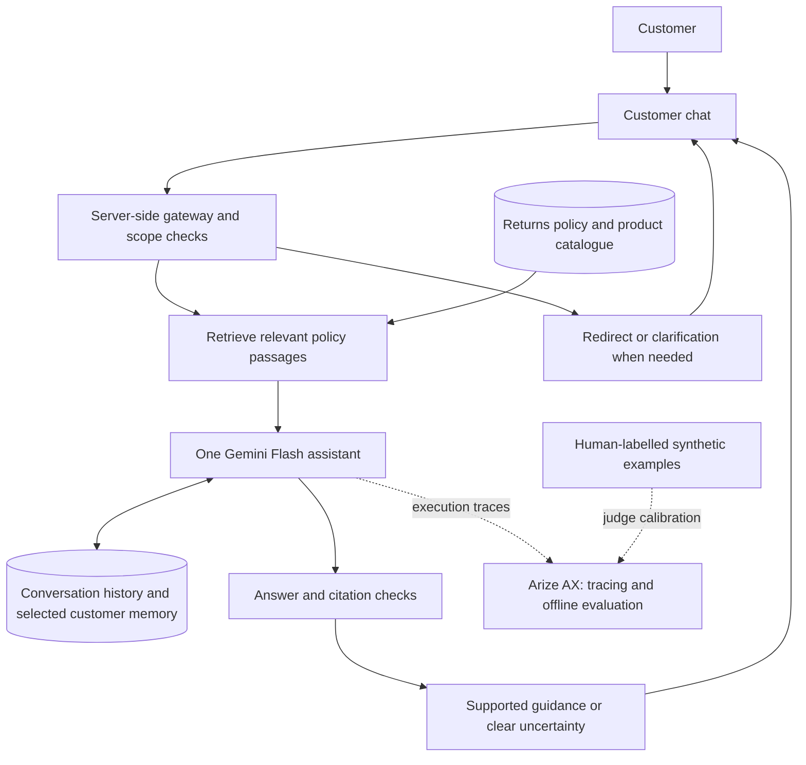

# Tarnfield Care — Returns & Exchanges Policy Assistant

Clear returns and exchanges guidance for customers of a fictional running
retailer. Tarnfield Care explains the relevant policy, shows its sources and
helps customers understand their next step.

**Status:** working local preview with cloud retrieval and conversation memory.
Initial judge calibration is recorded; independent validation and evaluation of
fresh assistant answers are still pending. The single-agent design is not yet
publicly deployed.

## Who it helps

Customers who need to know whether an item can be returned or exchanged, including
faulty products and special editions. Today, they would search policy pages,
compare exceptions and explain the same details again when asking for help.

## The problem

A return can depend on when an item arrived, its condition and product-specific
exceptions. Finding one clause is not enough: customers need an explanation that
applies the relevant rules to their situation without inventing eligibility.

The intended benefit is less time searching and less repeated context. Customer
task completion and time saved still need to be measured.

## Why AI?

AI helps interpret everyday questions and explain policy in plain language.
Retrieval supplies the policy passages for each answer. Ordinary software handles
source restrictions, sample-order dates and citation checks.

One assistant keeps the workflow simple. More agents would add coordination,
latency and cost without a clear need in this narrow task.

## What success means

These are proposed release targets, not measured product results.

| Outcome | Target |
|---|---|
| Correct policy guidance | At least 90% accuracy on held-out cases |
| Inspectable evidence | At least 95% of policy decisions cite evidence; every displayed citation comes from retrieved material |
| Clear capability limits | All critical scope and action-request cases handled correctly; no offers, promises or claims of unavailable actions |
| Useful continuity | At least 90% success on relevant recall cases; no cross-customer leaks in testing |
| Responsive help | 95% of completed responses within 8 seconds |

## The customer experience

Customers ask a question, receive a concise explanation and can inspect the
supporting passage or original policy. Conversation history lets them pick up
where they left off. The assistant asks for missing details and explains when
the available evidence is insufficient.

If a customer asks “Please arrange an exchange,” it states that it cannot carry
out the exchange, then gives supported policy guidance when evidence is
available. Customers take the next step themselves. The assistant cannot issue
refunds, arrange exchanges, file tickets or contact staff.

Unrelated questions receive a brief redirect. For mixed questions, the intended
behaviour is to answer the returns or exchanges part and redirect the rest.
Answers appear after validation, with a visible progress indicator while waiting.

## How it works



| Component | Purpose |
|---|---|
| Next.js chat and FastAPI gateway | Present the conversation and keep credentials on the server |
| Google ADK with Gemini 3.8 Flash | Produce one policy response after retrieval, with bounded retries |
| Google Cloud RAG | Retrieve fresh evidence from the returns policy and product catalogue |
| Managed sessions and Memory Bank | Preserve conversations and recall selected order, item and issue details |
| Answer and citation checks | Reject malformed answers, unknown source references and detected action promises |
| Arize AX | Inspect execution and calibrate quality judges on synthetic examples |

The preview runs the agent locally while using Google Cloud for retrieval and,
by default, conversation state. Memory provides customer context; it never
replaces current policy evidence. Citation checks confirm where a source came
from; evaluation must still assess whether it supports the answer.

## How quality is evaluated

Three criteria are scored separately:

| Criterion | Question |
|---|---|
| Correctness | Is the policy explanation right for this situation? |
| Grounding | Do the supplied passages support the claims and citations? |
| Scope and safety | Does the assistant stay within its role and respect privacy and capability limits? |

Scores are 0 (fail), 1 (partial) or 2 (meets the criterion), with N/A where a
criterion does not apply. Scores are never averaged: a correct answer cannot
cancel out an unsafe promise. Exact policy quotations are optional; supported,
clear paraphrases are welcome.

The evaluation log records each of the three Arize judges matching all eight
human-labelled calibration examples in its latest version. These are hand-written
answers used to tune the judges, not fresh assistant outputs or an independent
test. Held-out judge validation comes next, followed by evaluation of the actual
assistant. [Evaluation approach and evidence](docs/evaluation.md).

## What is monitored

Automatic Arize traces help investigate model usage, latency and failures.
Prompt and response content is masked by default. Synthetic offline evaluation
uses a separate dataset, so calibration does not require capturing customer chats.

Trace delivery has been demonstrated on the earlier deployment. The current
managed-state path still needs end-to-end trace and privacy verification.
Online quality evaluation, alerting and retention controls remain release work.
[Observability guide](docs/observability.md).

## How the product improves

Confusing answers, unsupported claims, missed exceptions and slow turns become
test cases. Compare changes on the same questions, keep independent test cases
separate, and review failures before claiming improvement.

Key tradeoffs are one assistant for lower coordination overhead, validated answers
before display for greater trust, and selective memory for less repetition.
Each needs evidence of its effect on quality, response time and cost.

## Safety and trust

The demo uses fictional policies and sample orders, with no connection to a real
retailer's order or payment systems. It explains policy and leaves actions with
the customer.

Retrieved passages and remembered details are treated as context, never as
instructions. Missing evidence should lead to uncertainty rather than a guess.
Scope rules and output checks reduce known failures but do not guarantee safety;
mixed requests, prompt injection and misleading citations need broader testing.

Browser continuity is not verified customer identity. Public release requires
stronger identity isolation, abuse controls, and clear consent, deletion and
retention arrangements.

## Running and operating the preview

Follow the [setup guide](docs/frontend.md) for dependencies, credentials and cloud
configuration. Then run these in separate terminals:

```bash
make chat-gateway
make chat-ui
```

Open [Tarnfield Care locally](http://127.0.0.1:3010).

Public hosting, deployment of the current agent, release monitoring and rollback
verification are pending. Earlier cloud services remain separate from the local
preview; their inventory is in the [deployment guide](docs/deployment.md).

Track cost per successful answer, including retrieval, memory, model calls,
retries and evaluation. There is no representative cost baseline for this design
or proof that one model call meets the latency target. [Cost and measurement](docs/costs.md).

## Evidence and remaining questions

Two recorded local smoke questions produced cited answers with one model response
each, taking 5.7 and 4.4 seconds. These are individual examples, not a latency
benchmark or a quality score. Deterministic checks cover application behaviour;
the [build report](docs/build-report.md) records their results and limits.

The [evaluation log](docs/ai-evals.md) records rubric decisions and preliminary
judge calibration. Independent judge validation, fresh assistant evaluations,
managed-memory isolation and customer outcome measures remain unproven.

## Further reading

| Document | Purpose |
|---|---|
| [Build and release plan](docs/build-plan.md) | Decisions, tradeoffs and release gates |
| [Evaluation guide](docs/evaluation.md) | Quality approach, current evidence and legacy runner |
| [Evaluation log](docs/ai-evals.md) | Human labels, calibration results and decisions |
| [Dataset guide](docs/eval-datasets.md) | Calibration inputs and fresh-output seed cases |
| [Arize evaluation setup](docs/arize-evaluation-setup.md) | Reproduce and extend offline judge calibration |
| [Frontend guide](docs/frontend.md) | Local setup and conversation behaviour |
| [Observability guide](docs/observability.md) | Tracing and privacy controls |
| [Deployment guide](docs/deployment.md) | Cloud inventory, release and recovery |
| [Cost guide](docs/costs.md) | Measurement plan and historical evidence |
| [Engineering notes](docs/engineering-notes.md) | Implementation details |
